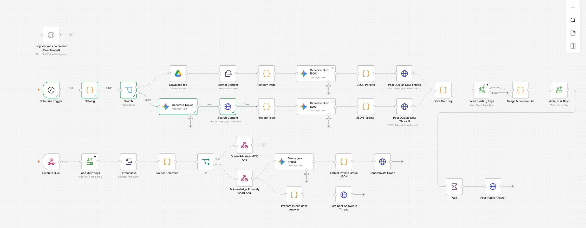
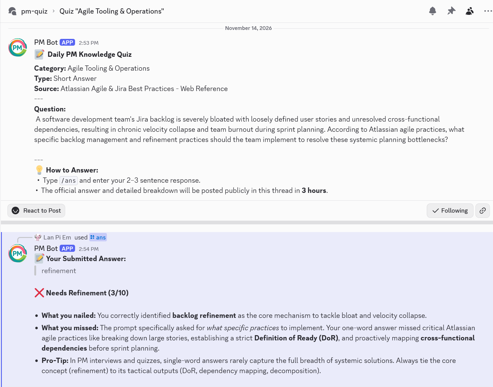

# n8n Discord Daily Quiz Bot

An automated Discord Forum quiz bot built with **n8n**, **Google Gemini**, and **Discord Interactions**.

Every day, the workflow generates a quiz from either a PDF knowledge source or live web research, posts it to a Discord Forum thread, grades responses privately, and publishes the official answer later.



---

## ✨ Features

* Daily automated quiz posting
* Discord Forum thread creation
* Single-choice, multiple-choice, and short-answer questions
* Private (ephemeral) grading for participants
* AI-assisted evaluation of free-text answers
* Automatic answer reveal after a configurable delay
* Quiz generation from PDFs or web research
* Easy to adapt to any subject or learning domain

---

## ⚙️ How It Works

Each day the workflow:

1. Selects a content source
2. Generates a quiz using Google Gemini
3. Creates a new Discord Forum thread
4. Accepts answers through buttons, dropdowns, or `/ans`
5. Grades responses privately using ephemeral messages
6. Posts the official answer and explanation after the quiz window closes

### Supported Question Types

| Type | Answer Method |
| :--- | :--- |
| **Single Choice** | Discord buttons |
| **Multiple Choice** | Discord dropdown |
| **Short Answer** | `/ans` slash command |



---

## 💡 Example Use Cases

* Project Management (PMBOK)
* AWS Certifications
* Cybersecurity Training
* Product Knowledge Assessments
* Compliance Training
* Internal Knowledge Sharing
* Technical Interview Practice
* Any topic with PDFs or publicly available references

---

## 📁 Repository Structure

```text
.
├── workflows/
│   └── discord-quiz-bot.json
├── docs/
│   ├── workflow-overview.png
│   └── discord-preview.png
├── setup/
│   └── Discord Quiz Bot Setup Guide.pdf
├── .env.example
├── docker-compose.yml
├── Caddyfile.example
└── README.md
```

---

## 📋 Prerequisites

Before importing the workflow, you will need:

### n8n
* Self-hosted n8n instance
* HTTPS-accessible domain
* Local filesystem access

> **Note:** Discord interaction webhooks require HTTPS.

### Discord
Create an application in the [Discord Developer Portal](https://discord.com/developers/applications) and obtain:
* **Application ID**
* **Public Key**
* **Bot Token**
* **Forum Channel ID**

**Required bot permissions:**
* `Send Messages`
* `Create Public Threads`
* `Send Messages in Threads`
* `Use Slash Commands`
* `Read Message History`

### AI & Content Sources
* **Required:**
  * Google Gemini API Key
* **Optional:**
  * Tavily API Key *(for web-research quizzes)*
  * Google Drive OAuth Credentials *(for PDF-based quizzes)*

---

## 🚀 Getting Started

See [`setup/Discord Quiz Bot Setup Guide.pdf`](setup/Discord%20Quiz%20Bot%20Setup%20Guide.pdf) for step-by-step instructions covering:

* Infrastructure setup
* Workflow import
* Discord configuration
* Registering the `/ans` command
* PDF-based quiz sources
* Web-research quiz sources
* Customizing prompts and quiz themes
* Troubleshooting

---

## 📄 License

MIT
